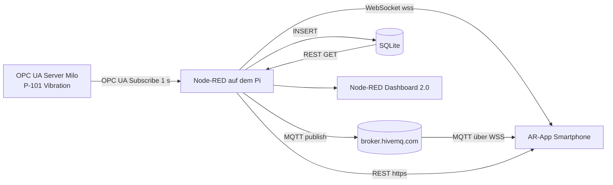

# Arbeitsaufträge: OPC UA → Node-RED → AR-App

Stand: der Raspberry Pi hängt im Schulnetz und ist von diesem Gerät aus nicht erreichbar.
Alles, was ohne Pi geht, ist in der App erledigt und getestet. Was auf dem Pi laufen muss, liegt als
importierbarer Flow vor (`nodered/vibration-flow.json`).

## Datenweg



## Inbetriebnahme auf dem Pi

1. Pakete installieren (Palette Manager oder `cd ~/.node-red && npm i ...`):
   `node-red-contrib-opcua`, `node-red-node-sqlite`, `@flowfuse/node-red-dashboard`
2. `nodered/vibration-flow.json` importieren (Menü → Import).
3. Tab-Einstellungen → Umgebungsvariablen: `KISTE` auf die eigene Kistennummer setzen.
4. Pfad der Datenbank im Node `sqlitedb` prüfen (Standard `/home/pi/vibration.db`).
5. Deploy. Der Debug-Node „Vibration (Aufgabe 1)“ zeigt die Messwerte.
6. Tunnel für WebSocket und REST (beides läuft auf Port 1880):

   ```bash
   ssh -R 80:localhost:1880 nokey@localhost.run
   ```

   Die ausgegebene `https://….lhr.life`-Adresse in der App eintragen:
   WebSocket `wss://<host>/ws/vibration`, REST-Basis `https://<host>`.
   Die App kann auch per URL konfiguriert werden: `index-test.html?kiste=7&wsUrl=wss://<host>/ws/vibration&apiUrl=https://<host>`.

> **Sicherheit:** Der Tunnel veröffentlicht ganz Port 1880, also auch den Node-RED-Editor.
> Vorher in `settings.js` `adminAuth` aktivieren oder den Tunnel nach der Übung schließen.
> Der Broker `broker.hivemq.com` ist öffentlich: jeder kann mitlesen und auf eure Topics schreiben.

## Zuordnung der Aufgaben

| Nr. | Aufgabe | Wo | Ohne Pi testbar |
|---|---|---|---|
| 1 | OPC UA lesen, Debug-Ausgabe | Flow: `Milo` → `Vibration (Aufgabe 1)` | nein, Flow auf dem Pi |
| 2 | WebSocket + Anzeige | Flow: `websocket out`, App: Panel „Aktueller Wert“ | App ja, mit Mock |
| 3 | MQTT publish | Flow: `HiveMQ publish` | nein |
| 3.1 | Fremde Topics | App: Tabelle „Andere Kisten“, Flow: Debug `/bbk-lf7/#` | ja, live |
| 4 | MQTT in der App als Text | App: Panel „MQTT-Nachricht als Text“ | ja, live |
| 5 | Datenbank + Ø 5 min | Flow: SQLite + `GET /api/vibration/avg5min` | nein |
| 7 | Daten der letzten 5 min | Flow: `GET /api/vibration/last5min` | nein |
| 8 | Verlauf als Chart | App: Chart.js | App ja, mit Mock |
| 9 | Datenmengen | unten | – |
| 10 | Dashboard 2.0 | Flow: `ui-gauge`, `ui-text` auf `/dashboard` | nein |

Die App fällt ohne Pi sauber zurück: MQTT läuft direkt zum Broker, der Verlauf kommt aus einem Browser-Puffer,
und über „als Quelle“ lässt sich die Kiste einer anderen Gruppe als Datenquelle nutzen.

## 3.1 Fremde Topics: Unterschiede

Gemessen am 03.11.2026 mit `/bbk-lf7/#` (Auszug, drei Gruppen mit ca. 1 Nachricht/s):

| Kiste | Format | Größe | Besonderheiten |
|---|---|---|---|
| 16, 11 | Klartext-Zahl | ca. 18 B | keine Einheit, kein Zeitstempel, volle Gleitkomma-Genauigkeit |
| 18 | JSON `source, nodeId, value, unit, timestamp, limits` | 195 B | Wert auf 3 Stellen gerundet, Grenzwerte `high 4.5`, `highHigh 7.1` |
| 22 | JSON `source, caseNo, nodeId, value, sourceTimestamp, receivedTimestamp, statusCode` | 247 B | volle Genauigkeit, OPC-UA-Qualität (`statusCode`), zwei Zeitstempel (Quelle/Empfang) |

Alle Gruppen lesen dieselbe OPC-UA-Node, die Werte sind also identisch bis auf Rundung und zeitlichen Versatz.
Unterschiede: Format (Zahl oder JSON), Feldnamen (`timestamp` oder `sourceTimestamp`), Rundung, Einheit/Grenzwerte, Größe.
Die App wertet alle drei Varianten aus (`parsePayload` in `assets/live.js`).

## 5.1 Relationsschema

```
sensor      (id PK, node_id UNIQUE, name, unit)
measurement (id PK, sensor_id FK → sensor.id, ts, value)      Index (sensor_id, ts)
```

`ts` ist Unix-Zeit in Millisekunden (UTC). Vollständiges DDL: [`schema.sql`](schema.sql).

## 5.2 SQL-Abfragen

Durchschnitt der letzten 5 Minuten (`GET /api/vibration/avg5min`):

```sql
SELECT AVG(value) AS avg, COUNT(*) AS count
FROM measurement
WHERE sensor_id = 1
  AND ts >= (CAST(strftime('%s', 'now') AS INTEGER) - 300) * 1000;
```

Rohdaten der letzten 5 Minuten (`GET /api/vibration/last5min`, Aufgabe 7):

```sql
SELECT ts, value
FROM measurement
WHERE sensor_id = 1
  AND ts >= (CAST(strftime('%s', 'now') AS INTEGER) - 300) * 1000
ORDER BY ts;
```

Weitere Abfragen in [`queries.sql`](queries.sql). Beide Abfragen sind gegen eine echte SQLite-Datenbank geprüft.

## 9 Datenmengen pro Tag

Der Server liefert ca. 1 Wert/s, das sind **86 400 Messwerte pro Tag** (bei Änderungs-Subscription ohne Filter).

| Ablage | Größe pro Tag | Grundlage |
|---|---|---|
| SQLite (Zeile + Index) | ca. 3,7 MB | gemessen: 86 400 Zeilen = 3 735 552 Byte |
| MQTT, JSON wie Kiste 18 | ca. 16,8 MB | 195 B × 86 400, ohne Header |
| MQTT, nur Klartext-Zahl `2.023` | ca. 0,4 MB | 5 B × 86 400 |

Auf einem Jahr hochgerechnet sind das ca. 1,4 GB Datenbank für einen einzigen Sensor.
Die genaue Zahl im eigenen Betrieb liefert die Abfrage „Messwerte pro Tag“ in `queries.sql`.

### 9.1 Reduktion

1. **Weniger abtasten:** Subscription-Intervall von 1 s auf z. B. 10 s. Faktor 10.
2. **Nur bei Änderung senden (Deadband):** Im OPC-UA-Node einen Deadband-Filter setzen. Bringt viel bei ruhigen Signalen, wenig bei dauernd schwankenden.
3. **Aggregieren:** Rohdaten nur kurz halten, dauerhaft Minutenmittel (Ø, min, max). 1 440 statt 86 400 Zeilen pro Tag, ca. 60× weniger.
4. **Aufbewahrungsfrist:** Rohdaten nach 24 h löschen (SQL in `queries.sql`).
5. **Schlankere Nutzlast:** nur Zahl und Zeitstempel statt 195-Byte-JSON, ggf. Binärformat (CBOR).
6. **Kompression:** gzip auf der REST-Antwort, bei vielen Werten pro Antwort sehr wirksam.
7. **Diagramm ausdünnen:** für die Anzeige reichen ca. 300 Punkte, der Server kann vorher mitteln.

## Was ist getestet?

- App (MQTT live gegen `broker.hivemq.com`, Chart, Fremde-Topics-Tabelle, Fallback): im Browser geprüft.
- SQL-Schema und Abfragen: gegen SQLite geprüft.
- Node-RED-Flow: lokal mit Node-RED 5.0.9, `node-red-contrib-opcua` 0.2.355, `node-red-node-sqlite` und Dashboard 2.0 (1.34.1)
  gegen den echten Milo-Server geprüft. OPC-UA-Subscribe, WebSocket, MQTT-Publish (gegen lokalen Broker), SQLite-Insert,
  beide REST-Endpunkte (mit CORS-Header) und `/dashboard` antworten. Dabei gefunden und im Flow behoben:
  die erste Nachricht nach dem Subscribe ist die Subscription-ID (`msg.topic = "subscriptionId"`) und würde sonst als Messwert gespeichert,
  und die DDL-Statements müssen nacheinander laufen (Delay-Node).
- Nicht getestet: Pi selbst, `localhost.run`-Tunnel, MQTT-Publish auf `broker.hivemq.com` (um fremde Topics nicht zu stören),
  Aussehen des Dashboards im Browser, Kamera/AR-Marker (im Test-Browser gesperrt).
